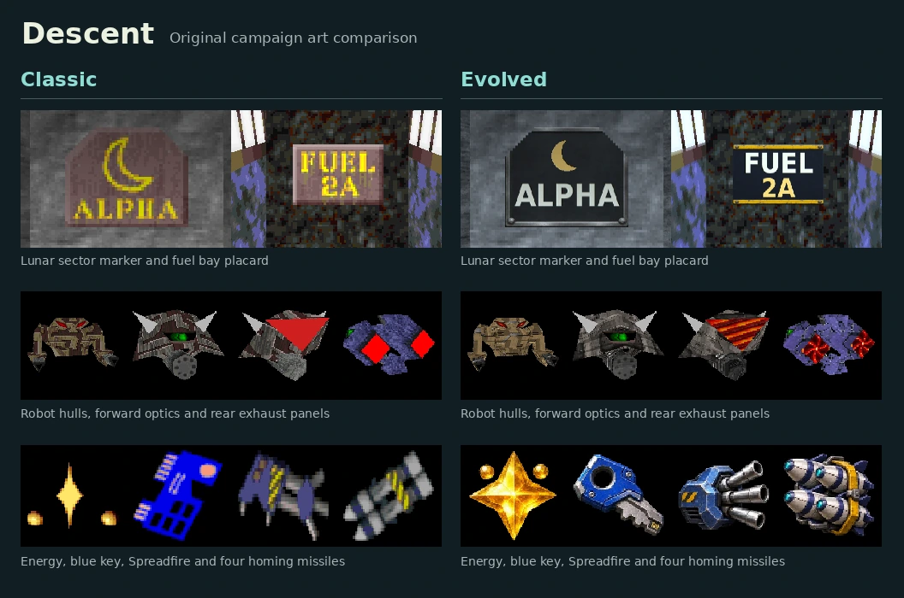

# Descent · Reactor Run

## Evolved flight art prompts and atlas manifest

These six production prompts made the Evolved pickup, robot-material, emissive machinery and blank-sign sheets. The campaign inventory came from reading placed objects in all seven bundled DOS shareware mines. Existing pickup sprites supplied identity and palette references. All replacement illustrations were generated from text using built-in ImageGen.

### Pickup atlas

`pickups.webp` is an sRGB RGBA WebP, 1152 × 576 pixels. The six columns and three rows contain 192 × 192 cells. Coordinates below start at the top left. Each subject fits within a 170 × 170 area centered inside its cell. The three input images each contain six sprites in a 3 × 2 grid. Their cells run left to right, then continue on the next row. Each input sheet becomes a single row in the published atlas.

| Atlas row | Column | Descent ID | Pickup | Identification cue |
| --- | --- | --- | --- | --- |
| 0 | 0 | 0 | Extra life | Green relief medallion with a silver ship |
| 0 | 1 | 1 | Energy | Golden four-point crystal and two captive beads |
| 0 | 2 | 2 | Shield boost | Blue sphere traced with white electrical branches |
| 0 | 3 | 4 | Blue access key | Blue bow with a circular aperture |
| 0 | 4 | 5 | Red access key | Red bow with two rectangular apertures |
| 0 | 5 | 6 | Gold access key | Gold body with three shoulder notches |
| 1 | 0 | 3 | Laser upgrade | Single emitter on a bronze-red receiver |
| 1 | 1 | 12 | Quad fire | Four bronze apertures around a luminous center |
| 1 | 2 | 13 | Vulcan cannon | Steel rotary cluster, dark chassis and ochre collar |
| 1 | 3 | 14 | Spreadfire cannon | Three splayed emitters on a blue receiver |
| 1 | 4 | 17 | Proximity mines | Crimson sphere in a silver diamond cage |
| 1 | 5 | 22 | Vulcan ammo | Belt of five brass cartridges with silver tips |
| 2 | 0 | 10 | Concussion missile | Single graphite body and silver nose |
| 2 | 1 | 11 | Four concussion missiles | Four matching projectiles in a yellow strap |
| 2 | 2 | 18 | Homing missile | Single ivory body, indigo bands and seeker optic |
| 2 | 3 | 19 | Four homing missiles | Four ivory bodies with seeker optics |
| 2 | 4 | 23 | Cloaking device | Magenta ring with a large central opening |
| 2 | 5 | 25 | Invulnerability | Deep blue sphere framed by silver triangular struts |

The training missions use the same blue, red and gold key art. Their energy cell maps to ID 1, shields to ID 2, spread cannon to ID 14, and the four-missile pickup to ID 11. Hostages use the game's separate rescue object.

### Robot material atlas

`robot-materials.webp` is an sRGB color atlas of 768 × 512 pixels. Each 256 × 256 square is an opaque, planar surface intended for a real rotating mesh.

| Tile | Column | Row | Surface |
| --- | --- | --- | --- |
| 0 | 0 | 0 | Ochre armor |
| 1 | 1 | 0 | Steel-blue armor |
| 2 | 2 | 0 | Red and brass armor |
| 3 | 0 | 1 | Dark flexible joints and vents |
| 4 | 1 | 1 | Silver access plate |
| 5 | 2 | 1 | Hostile optic |

The seven mines place robot IDs 0, 1, 2, 3, 4, 16, 17, 18, 19 and 20. The materials describe surfaces such as armor and sensors, so one robot may use several tiles. Native hues and sensor masks can be retained where they identify a model. Keep the mesh facing, joint animation and characteristic outlines.

### Robot emissive atlas

`robot-emissives.webp` is an opaque 512 × 256 sRGB atlas with two 256 × 256 tiles. The left tile depicts an axial thruster with a hot spindle and six swept vanes. The right tile depicts an orange-red heat exchanger with diagonal dark louvers. Use them on the original red emissive facets. Both retain a recognizable mechanical pattern when sampled through a square, diamond or triangular mask at 24, 32 and 40 pixels.

### Sign carrier atlas

`sign-carriers.webp` contains four opaque 256 × 256 carrier faces in a 512 × 512 atlas. The generated art supplies finish and hardware. The lettering and symbols are applied separately from the game's verified sign content, including the Alpha and Beta identifiers, fuel code, hazard marks and the retracting exit sign.

| Tile | Column | Row | Carrier finish |
| --- | --- | --- | --- |
| 0 | 0 | 0 | Green rails |
| 1 | 1 | 0 | Amber rails |
| 2 | 0 | 1 | Red rails |
| 3 | 1 | 1 | Silver frame |

### Lettering and silhouettes in the game

Lettering is set after image generation. This lets the colored rail, type size, and symbol fit the actual placard. The six original mine overlays use ALPHA and BETA with a crescent, FUEL 2A, the lightning bolt, WARNING with the biohazard symbol, and DANGER. The DANGER panel recessed into a metal wall uses the same lettering. On the sliding exit hatch, EXIT travels with the moving panel and disappears behind the lintel.

In flight school, the gate labels read BLUE KEY REQUIRED, YELLOW KEY REQUIRED, and RED KEY REQUIRED. Each pairs its color with the written key name and a key pictogram. The outer hatch reads EXIT AIRLOCK. Scouts have an ochre survey body and a single cyan lens. Gunners have a steel-blue box chassis with twin barrels. Hunters have red swept wings and a narrow nose.

### Reusing the prompts

For more pickups, replace the six numbered subjects while retaining the shared sheet instructions. Reserve distinct silhouettes for pickups that use the same hue. For example, the shield globe and invulnerability field both read blue, while the latter has a bright external triangle. Inspect new sheets on both a dark mine background and a neutral gray background. Verify the object count in each ammunition bundle before packing it.

For new enemy finishes, specify the material as a front-facing swatch. The active mesh supplies the perspective. For new signs, supply only the substrate to ImageGen and use source-verified wording, orientation and frames when composing the final texture.

### Production prompts

The three pickup calls used a common opening exactly as shown below, followed by the appropriate sheet instructions. Each call requested a transparent background. The armor, emissive machinery and sign calls requested opaque backgrounds.

#### Shared pickup instructions

> Use case: stylized-concept. Production in-flight collectible sprite atlas for a 1990s
> six-degrees-of-freedom deep space mining game, reimagined as exceptionally crisp hand-painted
> 3D industrial equipment. Landscape 3:2 canvas. Lay out precisely six separate objects, in an
> exactly aligned 3-column by 2-row invisible grid of square cells. One complete object centered
> at x=1/6, 1/2, 5/6 canvas width, y=1/4, 3/4 canvas height. Each occupies at most 75% of its
> own cell in either direction, visibly padded on every side. Match the scale. Transparent
> background, clean alpha cutout, all holes clear. No ground, shadow plane, sparks, ambient glow
> outside the silhouettes, frame, text, labels, numbers, guides, pedestals, scene or decorative
> extra things. Form dominant at 36 pixels in flight. Physical original designs in worn steel,
> chunky angular bevels, locally luminous glass, hard white key light upper left, some
> contrasting rims, few large details, polished indie sci-fi key art. Keep the silhouettes
> bright, well lit, with rich deep shadows inside.

#### Sheet A · resources and keys

> Row ONE from left: (1) extra life, a compact jade-green circular spacecraft transponder,
> beside no other objects, a bright silver recognizable little ship emblem built into its face,
> green rim. (2) energy, a radiant bright golden four-point energy crystal with two small golden
> captive satellite beads flanking the upper tips, no container. (3) shield boost, a translucent
> deep electric blue spherical force-field globe with bright branching icy-white electrical arcs
> around its lower edge, faceted blue core. Row TWO from left: three very distinct access keys,
> blue first, red second, yellow-gold third. Each a compact flat futuristic electronic
> access-card key with a small slim connector at lower right, bright colored plated body, steel
> teeth, three-quarter view slightly clockwise. Blue key has single large circular aperture in
> its bow, red key has two rectangular apertures, gold key has three narrow notches on its
> shoulder. Strong canonical BLUE, RED, YELLOW bodies. Keys should actually be keys and present
> their broad identifying face, lying alone in space.

#### Sheet B · weapons and ammunition

> All six objects are miniature, fictional and stylized spacecraft equipment modules. Row ONE
> from left: (1) a laser upgrade, a compact rose-bronze boxy laser cannon chassis with ONE long
> silver emitter barrel facing upper-right, pale ruby lens and tiny black-and-yellow service
> marks. (2) quad fire, a symmetrical four-way metallic gun carriage, FOUR bronze-black tubes
> facing toward camera with four unmistakable circular apertures arranged in a 2 by 2 square,
> central cyan accent. (3) rotary Vulcan cannon upgrade, front three-quarter view of a charcoal
> receiver with a bold bundle of six silver tubes projecting right, one yellow band around
> receiver. Row TWO from left: (1) spreadfire cannon upgrade, sapphire-blue angular blocky
> receiver, three short outward-spreading silver emitters opening like a fan, yellow marking.
> (2) a single proximity mine, a crimson luminous orb seated in a thick silver diamond-shaped
> metal cage, frontal, bright red core and silver diamond clearly visible. (3) Vulcan
> ammunition, short belt of FIVE obvious chunky sci-fi cartridge shapes with silver conical
> tips, brass cases and yellow-and-black striped belt keeper, diagonal. Equipment objects have
> no hands, characters, terrain, barrels projecting into adjacent tiles, labels or logos.

#### Sheet C · missiles and temporary equipment

> Row ONE from left: (1) one compact unguided spacecraft ordnance pickup with dark steel body,
> stub fins, blunt pale silver nosecone aimed up-left across the tile, O N E only. (2) a clearly
> visible pack of FOUR of these identical charcoal-and-silver small supply projectiles pointing
> up-left, carried in a compact 2x2 mechanical bundle held by one yellow band. Show four silver
> nose cones distinctly. (3) one homing spacecraft ordnance pickup, bright ivory-white segmented
> body with dark indigo bands & three small dark blue stabilizers, a tiny cyan seeker optic,
> angled up-left. Row TWO from left: (1) a pack of FOUR identical ivory spacecraft homing supply
> projectiles with indigo markings and stabilizers, parallel in a compact 2x2 bundle, four nose
> cones distinct and cyan seeker optics. (2) cloak powerup, a violet-magenta toroidal field
> module with a genuine circular black central opening, smooth glossy purple segmented ring
> crossed by a few black metal bands; its empty center is critical. (3) invulnerability powerup,
> dense luminous midnight-blue sphere protected by bright titanium triangular orbital struts,
> one unmistakable silver triangular outline traverses the front; visibly different from a
> shield globe. Sci-fi collectible inventory art, counted grouping for the first four cells is
> important.

#### Robot surface materials

> Use case: stylized-concept. Generate a production-ready planar robot armor texture atlas for
> an Evolved 1990s space mine game. Exact edge-to-edge landscape 3:2 atlas, 3 equal square
> columns x 2 rows, no gridlines, borders, gaps or labels. Each cell is a FACE-ON photographic
> orthographic scan of a completely opaque mechanical surface, filling its WHOLE square, no
> perspective, objects, machines, robots or visible outer edge. Worn heavy equipment, plausible
> brushed metal with dark recessed panel seams, believable light edge wear, large shapes bold
> and readable on low polygon game meshes. Uniform studio material light, neutral grays remain
> visible in dark scenes, minimal grime and small details. Row 1, left: mustard ochre industrial
> enamel armor plating, overlapping angular gold steel plates, broad yellow-ochre surfaces cover
> 70% of square, few broad bright exposed aluminum bevels and bolts, thin black service slots.
> Middle: cool desaturated blue-teal gunmetal armor, including broad pure steel-blue ceramic
> plates and chamfered silver edges. Right: oxblood vermilion / dark brass heavy armor, big red
> enamel plates, twin brass port strips. Row 2, left: flexible graphite black rubberized robot
> joint with broad silver ribbed bellows, darker vent recesses, transverse repeating pads.
> Middle: light brushed silver and cool steel armor plating, a clear recessed wide access port,
> a few worn bolt heads and chunky steel seams. Right: black sensor bezel carrying a SINGLE
> bright reddish-orange hostile eye lens at dead center with dark crimson concentric rings,
> optic occupies 55% of the square, graphite metal outside the lens. Material thumbnails only.
> If folded around a mesh these should read as actual machinery. No chevron arrows, words,
> digits or letters. Align cell boundaries to the mathematical thirds and half.

#### Blank industrial signs

> Use case: stylized-concept. A game texture atlas of FOUR completely blank sci-fi industrial
> wayfinding sign blanks, front elevation, exactly 2 columns by 2 rows on a square canvas split
> into four equal squares. Each square is entirely filled by one panel face, rectangular metal
> surface extending to all four borders, no scene, mounting wall, picture outline or cast
> shadow. These will be cropped and mapped onto existing mine signs; they must be perfect front
> view, axis aligned. All central areas, the full central 78 percent of each panel, are empty,
> flat, very dark matte metal suitable for exact typography to be added later. Sparse high
> craftsmanship, sharply focused DLC quality. Four clear variations familiar to a worn 1990s
> industrial lunar mine. Upper left: brushed slate green-charcoal instrument placard, with a
> muted sage enamel hairline top and bottom, corner screws. Upper right: deep navy-black powder
> coat with restrained aged yellow industrial enamel rails across the top and bottom edges,
> small bolts. Lower left: dark graphite control access plate with muted red enamel slim top and
> bottom edges, tiny exposed steel brackets in corners. Lower right: neutral blackened steel
> location plate, brightly brushed steel raised edges and bolt heads, no strong color. In each
> panel keep visual features around extreme outer 8 percent, large central surface perfectly
> blank, texture faint, no scratches that resemble words, no symbols, no pictograms, no
> lettering, no digits, no arrows. No overlapping cells, no empty gutters. Even frontal light,
> no vanishing point.

#### Emissive robot machinery

> Use case: stylized-concept. Texture artist production brief. Create one edge-to-edge 2:1
> landscape material atlas divided mathematically at center into TWO equal square swatches, left
> and right. Orthographic front elevation of emissive machinery inside a retro-futuristic heavy
> mining robot, for in-game texture mapping onto original low-poly red hull facets. No model or
> assembled robot, no three-quarter view, no scene, no separation gutter. The very small game
> polygon will sometimes crop the tile edges into a diamond or triangle, so build dominant
> physical machinery into the central 45 percent of BOTH squares. High contrast, LARGE legible
> internal forms, white-hot highlights sparse. Intense scarlet to red-orange at the perimeter on
> all four sides of both cells so facets retain the original enemy's hostile red silhouette.
> LEFT square is an incandescent axial THRUSTER viewed straight down its throat: a small
> white-orange heated central spindle about 12% of the square width, surrounded by SIX very
> broad, dark maroon swept turbine vanes with intense cherry-red hot blade edges. Six blunt
> shapes form an immediately readable radial pinwheel at icon size. Vanes extend inward and meet
> the center spindle. One broad orange-red annulus and molten scarlet hot metal toward the outer
> square corners. No black outer mount, no huge glowing circle masking the vanes, no external
> hardware frame. RIGHT square is an intensely radiant RED-ORANGE HEAT EXCHANGER: five widely
> spaced parallel diagonal charcoal-red metal louvers, each thick and beveled, casting black-red
> recesses across a glowing red-orange furnace backing. Broad hot ribs alternating with five
> clearly dark slats, some directly through the center. Slats run bottom-left to top-right
> across the full planar face. Outer ends fade into strongly red hot edges. Pure surface color,
> polished hard-surface game art, with crystalline large forms and sculpted relief readable when
> reduced to only 24 pixels square. No text, no digits, no UI, no wireframes, no loose sparks,
> no atmosphere, no all-black band around either cell.
